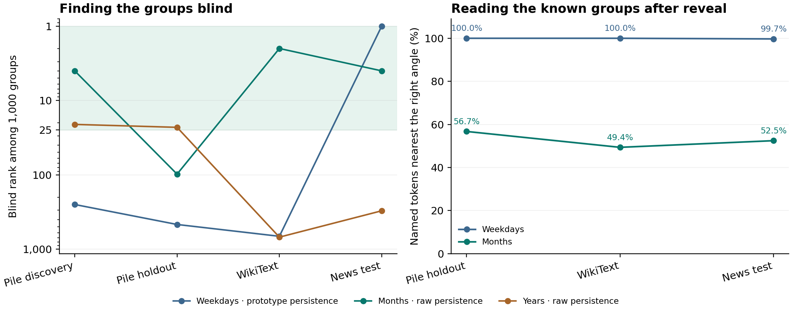
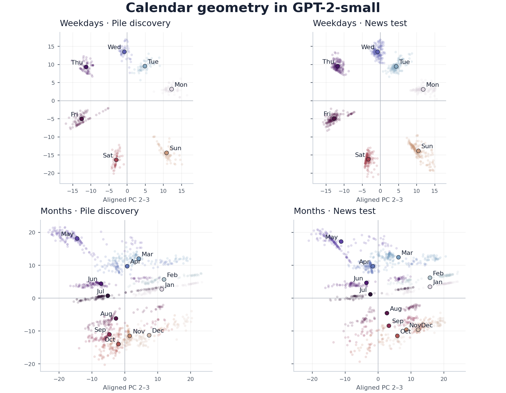
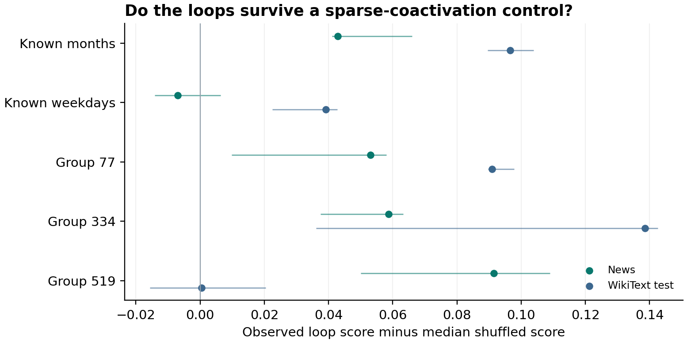
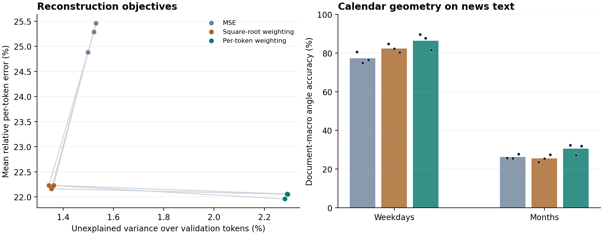
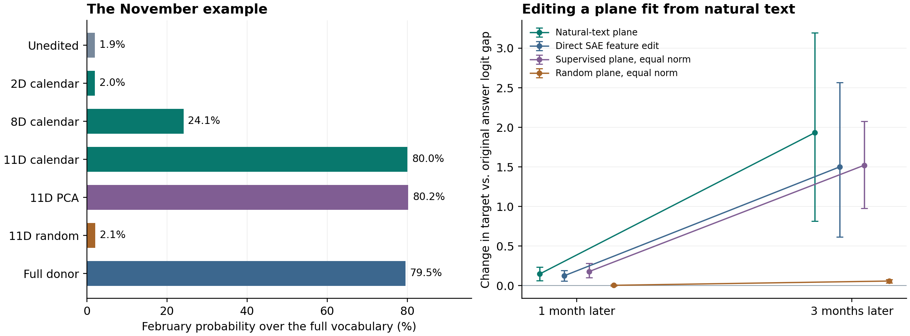
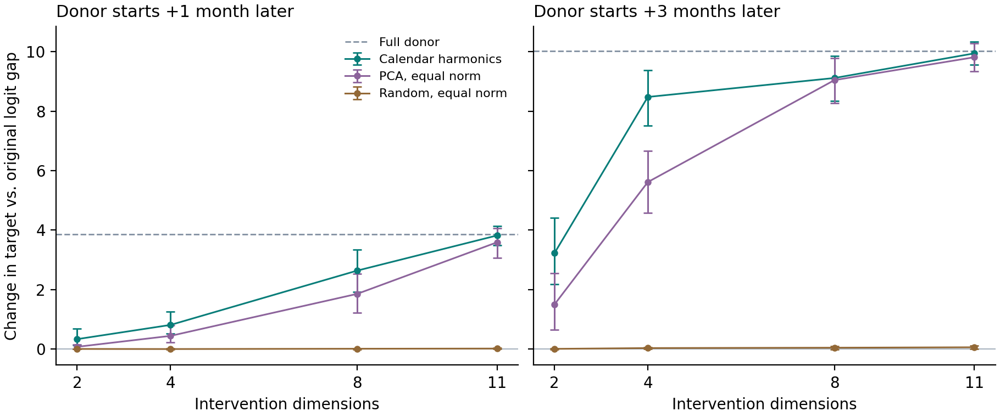
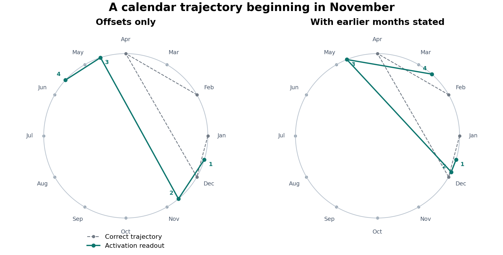

# What GPT-2 and Mistral encode about calendars

Frozen GPT-2-small represents named weekdays in their calendar order across held-out news articles. A blind ranking surfaced the month group more reliably across corpora. In Mistral, a two-dimensional calendar edit moved the target logit on average. On the November example, an 11-dimensional edit made February the top next token.

The [Jupyter tutorials](notebooks/README.md) run on CPU with bundled examples. The [experiment README](README.md) describes the models, corpus splits, and commands for reproducing the full study.

## Discovery without labels

We reconstructed each published GPT-2 group using only its own sparse-autoencoder latents. The ranking used distances in those point clouds while token identities were hidden. After ranking, we revealed the names and measured how close each named token landed to its calendar angle in a fixed projection.

The left panel puts rank 1 at the top and shades the top 25. The month group ranked first by the geometric mean of raw ranks across the four corpora. The weekday group ranked first on news using prototype persistence, which scores the centroids of clustered points. Reranking under that method in the other corpora placed weekdays between 251st and 672nd. The right panel shows why the two measurements matter. In news, the labeled weekday point cloud placed 1,363 of 1,367 tokens nearest the correct weekday angle across 466 documents. One document contributed 94.7% of labeled weekday tokens in the Pile holdout. [Full rankings](results/rankings/) · [Consensus table](results/document-controls/corpus-consensus-ranks.csv) · [News label reveal](results/document-controls/calendar-results.csv)

The year group formed an ordered arc in the third and fourth principal components. Its mean circular year error was 4.4–4.7 years over the three held-out corpora. Months were harder to place than weekdays, and the fixed weekday readout was sensitive to abbreviations and case in newly written prompts. [Year geometry](results/year-geometry/year-geometry.png) · [Calendar format comparison](results/format-transfer/calendar-format-transfer.png)

### What survived additional controls

The controls preserve each sampled token's number of active latents and each latent's nonzero activation values while shuffling which latents occur together. Points show the median difference across three samples per corpus, with lines covering the observed range. After scoring, candidate 334's strongest news examples frequently contained `legs` or `feet`, and a separate group consistently captured `-ing` tokens. Their underlying semantic geometry remains open. The [injected-shape benchmark](results/geometry-benchmark/geometry-benchmark.png) shows how sampling and signal strength affect loop detection when a ring is planted in real activation backgrounds. [Candidate audit](results/discovery/candidate-audit/candidate-audit.csv) · [Revealed terms](results/discovery/candidate-audit/candidate-labels.csv) · [Suffix candidate plot](results/discovery/candidate-271.png)

Blind clustering using decoder directions and coactivation recovered every published weekday and month latent inside larger groups. The broader weekday group's news accuracy was 17%, and the broader month group's was 43%. Selecting smaller subgroups by blind persistence improved the news raw score in 340 of 548 changed groups. In the matched month group, prototype rank improved from 639 to 12 and angle accuracy fell to 29%. Membership, geometric score, and semantic ordering are three observable outcomes. [Clustering matches](results/discovery/fine-groups/clustering-results.json) · [Subgroup results](results/discovery/group-refinement/geometry/calendar-results.csv)

## What the new autoencoders recovered

The independently trained TopK dictionary recovered weekday order across multiple groups. Its three closest groups reached 85% angular accuracy on active named weekdays in the Pile holdout, with 98% coverage. The full block-sparse model reached 35% in the same corpus. Both used 3,072 latents. [TopK comparison](results/topk/dictionary-comparison.csv) · [Block-sparse comparison](results/block/dictionary-comparison.csv)

The full validation FVU is the fraction of residual variance missed by reconstruction. It can be much smaller than the same quantity computed only on calendar tokens. The original independent TopK run missed 1.35% of full-validation variance and 43% on named weekdays in the Pile holdout. [Same-token reconstruction table](results/reconstruction-geometry/reconstruction-geometry.csv)

The matched comparison uses three seeds and identical data, batch draws, and training steps across the three loss objectives. Full per-token weighting raised mean news weekday accuracy from 77.3% to 86.3% and month accuracy from 26.3% to 30.5%. Square-root weighting gave the lowest whole-validation FVU at 1.35%. Each dot on the right represents one run. Its accuracy weights documents equally. [Validation data](results/token-loss/matched-loss-validation.csv) · [Geometry data](results/token-loss/matched-loss-geometry.csv)

## What changed Mistral’s answer

The short prompt `Two months after November is` produced a non-month token. Adding *Let's do some calendar math* and using the paper's phrasing made January the top completion. We edited the activation at the **input November token** toward the corresponding December activation. For the framed test, the target next token is February. [Prompt framing results](results/steering/framing-summary.json)

The left panel shows that the 2D edit barely changed the November answer. The 11D month subspace and same-norm 11D PCA edit both raised February to about 80%. The mean across three 11D random edits was near 2%. The right panel uses a different, fixed layer. It reports the average change in the target-versus-original logit gap after fitting the published Mistral SAE plane on 97,536 natural-text tokens with labels hidden. Across 72 one-month edits, that plane improved the gap by 0.147, compared with 0.004 for norm-matched random directions. The 95% intervals resample source months. [Exact example and dimension sweep](results/steering/harmonics/harmonic-metadata.json) · [Natural-text fit and interventions](results/steering/published-sae/sae-plane-steering.json)

The circle alone explains some average intervention effect. Month information also mattered outside the first two coordinates. Larger calendar and PCA subspaces both recovered most of the full donor effect. These measurements use the 4-bit Mistral-7B-v0.1 checkpoint and a small family of calendar prompts. [Layer and offset sweep](results/steering/stronger/mistral-steering.json) · [Ellipse versus chord](results/steering/stronger/mistral-paths.json) · [Multiple-layer edits](results/steering/multi-layer-steering/multi-layer-summary.json)

### Calendar state over a longer prompt

The figure projects an answer-position readout for a separate prompt at each depth. Across four-move examples, its month accuracy was 12.5% when only the cumulative instructions were present and 91.7% when the earlier months were stated. The four-step model accuracy among month tokens was 8.3% and 100%, respectively. [Trajectory table](results/steering/calendar-trajectories/calendar-trajectory-summary.csv)

## How the readings connect

- The blind ranking addresses MAISI's question about systematically finding feature manifolds. The positive controls come from Engels et al.'s published GPT-2 and Mistral groups. [MAISI research direction](https://maisi.org/research/directions/interpretability-feature-manifolds) · [Engels et al.](https://arxiv.org/html/2405.14860#S4)
- Goodfire's geometry overview connects the shapes of activations with the structure of concepts. Its steering study tests edits along a fitted geometry, including a weekday case. Those are the precedents for our shape benchmark and arc, chord, and random-direction comparisons. [The World Inside Neural Networks](https://www.goodfire.com/research/the-world-inside-neural-networks) · [Steering Along Manifolds](https://www.goodfire.com/research/manifold-steering)
- Goodfire's story study reads changes in emotion representations over successive story prefixes. Our calendar trajectory applies the prefix idea to a small arithmetic task with a known target at each depth. [Meandering on Manifolds](https://www.goodfire.com/research/stories-in-space)
